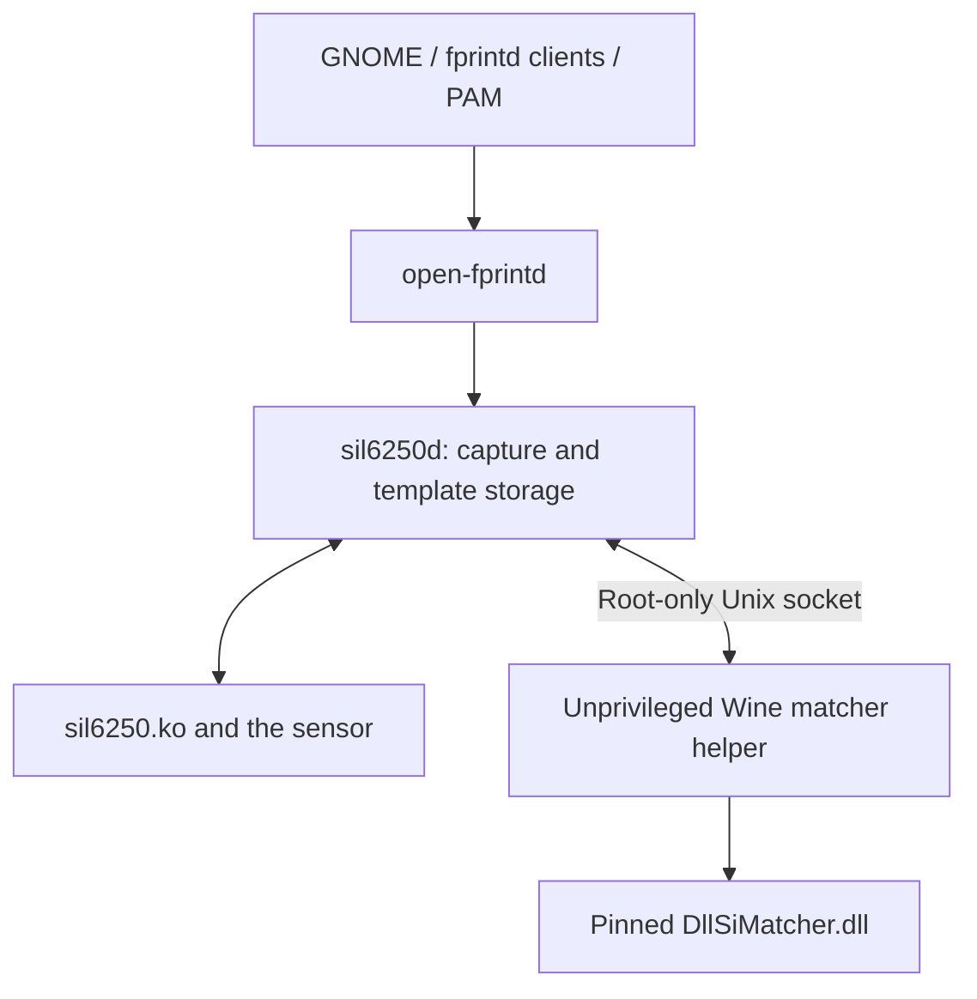

# SIL6250 investigation: findings, methods, and end result

**Investigation date:** 2026-10-26

**Test device:** Huawei MateBook 14 2024, FLMH-XX / M1010

**Outcome:** Fingerprint PAM authentication enabled through an isolated local
vendor-library helper; a reliable native replacement for this unit remains
unfinished.

## 1. End result

The working configuration uses the community Linux driver for hardware access
and capture, `open-fprintd` for the desktop interface, and the official Petaic
matching library under Wine for identity decisions. The right index finger is
enrolled. The standard fingerprint PAM profile and startup services are enabled,
with password fallback retained.

Fresh verification through the fingerprint service recognized **6 of 8 index
presses** and rejected **all 8 presses of the unenrolled thumb**. A subsequent
authentication through the real `sudo` PAM stack succeeded on its first attempt.
That test ran as the desktop user with standard input closed, so it could not
succeed by entering a password.

This is a usable, device-specific interim result. Occasional retries or password
fallback remain necessary. The small test set does not establish production
biometric error rates or the security properties of the complete Windows Hello
implementation.

## 2. Hardware, software, and starting point

| Component | Tested value |
| --- | --- |
| Laptop | Huawei MateBook 14 2024, product FLMH-XX, product version M1010 |
| Fingerprint identification | ACPI `SIL6250:00`, path `\_SB.SPBA` |
| Sensor firmware | `0.0.32.15` |
| Captured image | 64 × 80 pixels, 5,120 raw bytes |
| Operating system | Ubuntu 26.10 |
| Kernel | `7.3.0-9-generic` |
| OpenSSL | `4.0.3` |
| Wine | `10.0` |
| Rust / Cargo | `1.97.1` / `1.97.1` |
| Secure Boot | Enabled |

The reader is a match-on-host device reached through an EC-arbitrated
shared-memory mailbox. The sensor supplies images; software on the host performs
matching. Its transport and capture protocol were already implemented by the
community project. This investigation reused that work and concentrated on
capture reliability, desktop integration, matcher comparison, and a local
vendor-library bridge. [Upstream architecture and reverse-engineering notes](https://github.com/AlexDaichendt/sil6250-linux/tree/cd19287313b92b1ccc236c95fd615467ac833648)

Exact starting revisions:

- `AlexDaichendt/sil6250-linux`:
  [`cd19287313b92b1ccc236c95fd615467ac833648`](https://github.com/AlexDaichendt/sil6250-linux/commit/cd19287313b92b1ccc236c95fd615467ac833648)
- `uunicorn/open-fprintd`:
  [`b7073730bccca36e84484e3fcb4f8253ea038d07`](https://github.com/uunicorn/open-fprintd/commit/b7073730bccca36e84484e3fcb4f8253ea038d07)

The initial installation of stock `fprintd` did not expose this reader. The
community stack loaded the module, provisioned the TLS connection, captured
checksum-valid images, and completed enrollments. Genuine-finger verification
still repeatedly returned `verify-no-match`. Enrollment also initially stalled
partway through its fifteen stages.

The owner reported that fingerprint sign-in had worked reliably in Windows.
That was useful background, but no controlled Windows Hello comparison was
performed during this investigation.

## 3. Methods

### 3.1 Separate transport, capture, and matching failures

Hardware identification used ACPI information and the firmware query. The
existing kernel broker was built through DKMS and signed using an already
trusted key on the test machine. Secure Boot remained enabled; firmware keys,
TPM state, and boot entries were not changed.

Transport was assessed through successful TLS provisioning, capture completion,
and image-checksum validation. Matching was assessed separately using repeated
physical presentations of the same finger and an unenrolled finger.

Two local capture fixes were made before drawing conclusions about recognition:

1. Capture failures were logged as errors instead of being silently discarded.
   Retry paths reopened the sensor connection rather than repeatedly reusing a
   failed session.
2. A capture stability gate selected a frame after two consecutive normalized
   images correlated at least `0.90`. This addressed unstable initial contact.
   Correlation was used for capture stability, not identity acceptance.

These changes helped enrollment complete, but separate-press recognition still
failed. Genuine Linux match scores commonly remained at 3–4 against an
acceptance requirement of 5 inliers. A template serialization round trip also
preserved a failing score, which ruled out serialization loss in that check.
The identity threshold was not reduced.

### 3.2 Use the official matching library as a comparison reference

The ACPI package **Petaic 3.9.5.23** was obtained from the
[Microsoft Update Catalog](https://www.catalog.update.microsoft.com/Search.aspx?q=ACPI%5CSIL6250).
Its INF identifies `ACPI\SIL6250`. The matching library was
`DllSiMatcher.dll`, with SHA256:

```
5859f8c56c35b4fb823a5facf97a795861582a2f10d1fbbd05467c755d3d8837
```

A local C harness loaded the library under a separate Wine prefix. PE inspection,
Capstone disassembly, and selected-function decompilation with angr were used to
trace its interface and feature-processing routines. The harness exercised native
quality assessment, enrollment, template creation, feature extraction, and
verification.

Important implementation details were:

- Vendor function pointers used the Win64 calling convention explicitly.
- Verification used its recovered six-argument interface, including the output
  quality structure.
- Image handling accounted for the 64 × 80 input and the library's internal
  68 × 84 padded representation.
- A vendor logging entry point was disabled in memory to avoid WPP tracing
  failures outside its normal Windows host. The on-disk DLL was unchanged.
- The library's default matching decisions were used without adjusting its
  acceptance thresholds.

Identical-image positive controls were checked first. They were accepted and
produced the expected saturated vendor score of 102. Subsequent comparisons used
separate physical presses. Vendor scores and Linux inlier counts have different
units and were never treated as numerically interchangeable.

The harness is a reference for this particular library invocation. It does not
reproduce the entire Windows Hello engine or its complete policy and spoof-check
pipeline.

### 3.3 Collect separate presses and preserve a held-out set

One participant supplied **16 separate right-index presses** and **8 separate
right-thumb presses**. The thumb was not enrolled in the comparison gallery.

For each presentation, collection retained an initial-contact frame, a selected
stable frame, and three further frames roughly 100 ms apart. The initial session
stopped after eight presentations; a reconnecting, resumable helper completed
the same dataset without discarding the saved presses.

The main offline comparison used:

- Index presses 1–8 as enrollment references, using one selected frame each.
- Index presses 9–16 as held-out genuine probes.
- Thumb presses 1–8 as wrong-finger controls from the same participant.
- Either the first selected probe frame, or the best result across the four
  collected frames of that presentation.

Raw images, transformed images, features, and templates stayed in private local
storage. This repository publishes aggregate results only.

## 4. Findings and measured results

### 4.1 More captures alone did not make the Linux matcher suitable

| Offline configuration | Correct index presses accepted / 8 | Wrong thumb presses accepted / 8 |
| --- | ---: | ---: |
| Linux baseline, first selected frame | 1 | 0 |
| Linux baseline, best of four frames | 3 | 1 |
| Vendor library, first selected frame | 4 | 0 |
| Vendor library, best of four frames | 4 | 0 |
| Linux RootSIFT research variant, best of four | 4 | 0 |
| Linux extraction on vendor-preprocessed images, best of four | 2 | 0 |
| Experimental 12-level Linux pyramid, best of four | 1 | 2 |

The vendor rows use its native eight-sample enrollment and its `RemoveLine`
preprocessing. Testing the library without that preprocessing gave the same
4/8 genuine and 0/8 wrong-finger acceptance counts in this held-out comparison.

Burst matching improved the Linux baseline's genuine acceptance count but also
accepted a thumb control. The pyramid prototype had the same problem. Neither
variant was enabled for authentication.

Substituting the vendor's preprocessed images into the Linux extractor also
failed to close the gap. That experiment cropped the padded result back to
64 × 80 for the Linux extractor, so it does not eliminate every possible
preprocessing or border-handling difference.

### 4.2 A larger reference gallery exposed a substantial software gap

A second analysis compared each index probe with the other fifteen index
references. Each thumb probe was compared with all sixteen index references.
The aggregation took the best single-reference pair result; it was not a newly
enrolled fifteen-image vendor template.

| Matcher | Index probes accepted / 16 | Thumb probes accepted / 8 |
| --- | ---: | ---: |
| Native Linux baseline | 3 | 1 |
| Official vendor library | 13 | 0 |

The same captured data therefore contained information the vendor library used
more successfully. These observations support further software investigation;
they do not establish an inherent error-rate ceiling for this sensor.

### 4.3 The feature representation differs from the Linux implementation

The recovered vendor path stores compact features in **40-byte keypoint records**.
Observed components include a **128-bit median-gradient signature**, an
**80-bit companion signature**, and associated position, orientation, and coverage
metadata. The median-signature step compares spatial gradient responses against
per-channel medians before packing bits.

The tested Linux extractor uses floating-point SIFT-style descriptors. Upstream
already documents an additional descriptor and deferred work; tracing the packed
representation provided a more specific target for further comparison.
[Upstream algorithm discussion](https://github.com/AlexDaichendt/sil6250-linux/blob/cd19287313b92b1ccc236c95fd615467ac833648/REVERSE_ENGINEERING_DETAILS.md)

Experimental median encodings, a larger image pyramid, and an auxiliary
descriptor approximation did not establish a reliable native replacement. A
faithful native feature pipeline and its matching policy still need to be
implemented and validated together.

## 5. Interim integration that worked

The chosen configuration keeps hardware access in the Linux stack and delegates
matching to the pinned library through a separate service:



The bridge implements enrollment, native template serialization and reload, and
verification. The candidate template reused the sixteen comparison
presentations: the vendor engine accepted fourteen samples, while two
presentations did not advance enrollment. The desktop enrollment path requires
fifteen accepted, separate stages for new enrollments.

The local integration includes these controls:

- The library runs under a dedicated unprivileged account, with no capabilities,
  home directories hidden, a read-only system filesystem, and address families
  restricted to Unix sockets.
- A root-owned mode-0600 socket carries bounded requests. The helper also checks
  the connecting peer's UID. Desktop users cannot connect directly.
- Protocol validation bounds message lengths, template lengths, and template
  counts. Malformed requests and inconsistent verification results fail closed.
- A successful response requires the native success result, native match flag,
  and a valid loaded-template index. Rust validates that response again.
- The DLL checksum is checked before the helper starts. The implementation uses
  build-specific entry points and is tied to the pinned binary.
- Native feature templates are saved atomically with root-only permissions.
  Normal authentication saves no raw scans.
- The local `open-fprintd` bridge restricts backend registration and privileged
  methods to root, and enrollment/deletion use asynchronous polkit checks.
- Capture cancellation prevents a replaced operation from publishing an old
  success result. Verification requests require a fresh finger presentation.

These are implementation controls and observed checks, not a formal security
audit. The helper's native ABI work and the Wine dependency remain part of the
interim configuration.

## 6. Final validation

After creating and reloading the native template, fresh physical presentations
were tested through the standard fingerprint D-Bus service. These were new
presses, independent of the offline dataset.

| Final validation | Result |
| --- | --- |
| Correct right index | 6 matches in 8 presentations |
| Unenrolled right thumb | 0 matches in 8 presentations |
| `pamtester sudo <user> authenticate`, as the desktop user with stdin closed | Success on first attempt |
| Native template packing and reload | Passed |
| Cold matcher-service restart and positive/negative controls | Passed |
| Manager suspend/resume control calls | Passed |
| Direct desktop-user access to matcher socket | Denied |
| Verification without loaded templates | Rejected |
| Oversized protocol request | Rejected |
| Pinned-library startup checksum | Passed |
| Library tests | 20 passed |
| Daemon tests | 8 passed; 1 optional isolated-bus test skipped |

The PAM test invokes the actual `sudo` authentication service directly. It does
not use a cached `sudo` credential or rely on the shell's `sudoers` permissions.
The account had a password configured, and password input was unavailable to the
test process.

The working backend, matcher socket, and sleep/resume hooks are enabled for
startup. The original password fallback is retained in the standard PAM stack.
Current measurements are recorded in
[the aggregate validation summary](results/validation-summary.json).

## 7. Limits and remaining native-driver work

The fresh recognition result is **75% first-presentation acceptance in eight
trials**, with occasional retries or password fallback still needed. All eight
wrong-finger presentations were rejected, but a repeated thumb from one person
is not a population impostor dataset. Population FAR/FRR and spoof resistance
were not measured.

A full final-stack reboot, real OS suspend/resume cycle, and separate GDM
lock-screen authentication were not exercised. Service restarts, saved-template
reload, manager power-management control calls, and the real PAM stack were
checked as described above. Additional-finger enrollment remains a path for
further live validation.

The native Linux port would benefit from these next steps:

1. Reproduce the vendor's keypoint selection, descriptor coverage handling,
   binary encodings, auxiliary descriptor, and geometric verification against
   controlled intermediate outputs.
2. Keep separate physical presses and multiple participants in evaluation.
   Reserve a fresh validation set after choosing a candidate implementation.
3. Measure genuine acceptance and wrong-finger acceptance together. More frames
   or a lower decision threshold cannot be assumed to preserve discrimination.
4. Validate template persistence, cancellation, enrollment through desktop
   settings, reboot behavior, and full suspend/resume before broader use.

## 8. Sources and attribution

- [AlexDaichendt/sil6250-linux, tested revision](https://github.com/AlexDaichendt/sil6250-linux/tree/cd19287313b92b1ccc236c95fd615467ac833648): kernel broker, transport, TLS provisioning, capture, and native matching baseline.
- [Upstream reverse-engineering account](https://github.com/AlexDaichendt/sil6250-linux/blob/cd19287313b92b1ccc236c95fd615467ac833648/REVERSE_ENGINEERING_DETAILS.md): architecture and earlier algorithm findings.
- [uunicorn/open-fprintd, tested revision](https://github.com/uunicorn/open-fprintd/tree/b7073730bccca36e84484e3fcb4f8253ea038d07): desktop fingerprint frontend used by the local backend.
- [Same-model upstream report](https://github.com/AlexDaichendt/sil6250-linux/issues/12): independent FLMH-XX report with the same firmware, providing useful compatibility context.
- [Microsoft Update Catalog, SIL6250 packages](https://www.catalog.update.microsoft.com/Search.aspx?q=ACPI%5CSIL6250): source of the tested Petaic package.

All numerical results in this report come from the local experiment and its
validation records. The repository contains the report and sanitized aggregate
evidence. Biometric samples, templates, signing keys, proprietary driver binaries,
and decompiled vendor listings were excluded from publication.
